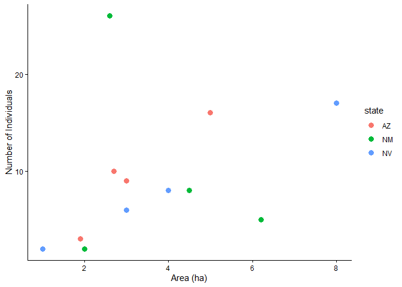
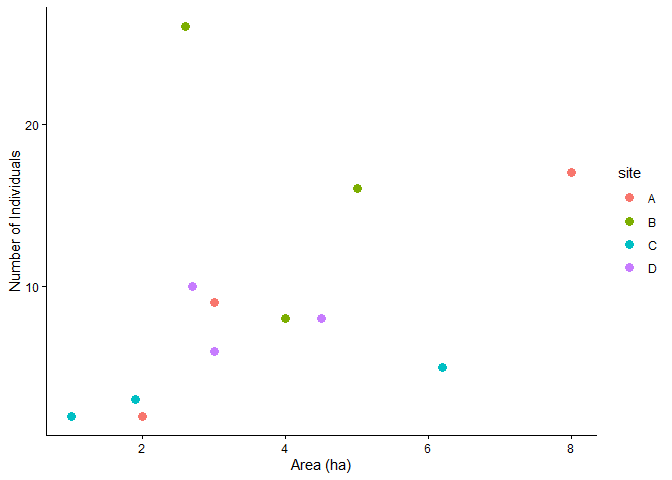
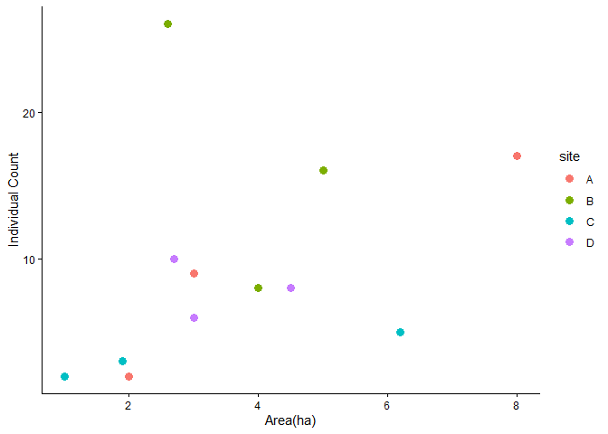
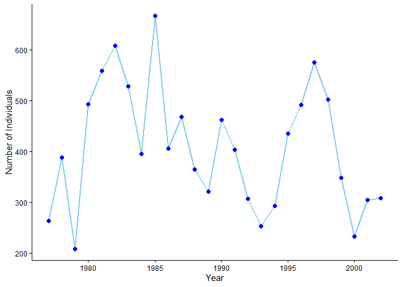
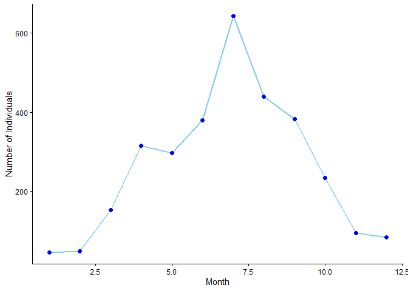
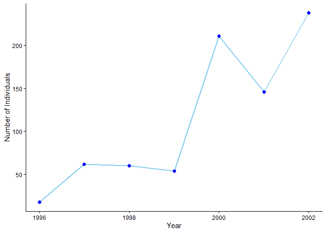

# Week 11 Assignment


# Assignment Details

### Purpose

The goal of this assignment is to practice writing our own functions and
using them.

### Task

Write R code to successfully answer each question below.

### Criteria for Success

- Code is within the provided code chunks or new code chunks are created
  where necessary
- Code chunks run without errors
- Code chunks have brief comments indicating which code is answering
  which part of the question
- Code will be assessed as follows:
  - Produces the correct answer using the requested approach: 100%
  - Generally uses the right approach, but a minor mistake results in an
    incorrect answer: 90%
  - Attempts to solve the problem and makes some progress using the core
    concept, but returns the wrong answer and does not demonstrate
    comfort with the core concept: 50%
  - Answer demonstrates a lack of understanding of the core concept: 0%
- Any questions requiring written answers are answered with sufficient
  detail

### Due Date

Nov 10 before class

# Assignment Exercises

### 1. Writing Functions: Part 1 (15 points)

1.  Copy the following function (which converts weights in pounds to
    weights in grams) and replace the `________` with the variable names
    for the input and output. Remove the comments and run the code to
    add the function to your environment.

    Use the function to calculate how many grams there are in 3.75
    pounds.

``` r
convert_pounds_to_grams <- function(pounds) {
     grams <- 453.6 * pounds
     return(grams)
}

convert_pounds_to_grams(pounds = 3.75)
```

    [1] 1701

2.  Copy the following function (which converts temperatures in
    Fahrenheit to temperatures in Celsius) and replace the `________`
    with the needed commands and variable names so that the function
    returns the calculated value for Celsius. Remove the comments and
    run the code to add the function to your environment.

    Use the function to calculate the temperature in Celsius if the
    temperature in Fahrenheit is 80°F.

``` r
convert_fahrenheit_to_celsius <- function(fahrenheit) {
     celsius <- (fahrenheit - 32) * 5 / 9
     return(celsius)
}

convert_fahrenheit_to_celsius(fahrenheit = 80)
```

    [1] 26.66667

3.  Write a function named `double` that takes a number as input and
    outputs that number multiplied by 2. Run it with an input of 512.

4.  Write a function named `prediction` that takes three arguments, `x`,
    `a`, and `b`, and returns `y`. Use the following equation
    `a + b * x` (like a prediction from a simple linear model). Run it
    with `x` = 12, `a` = 6, and `b` = 0.8.

``` r
#1c
double <- function(number){
  double <- (number*2)
  return(double)
}

double(512)
```

    [1] 1024

``` r
#1d
prediction <- function(x, a, b){
  equation <- a+b*x
  return(equation)
}

prediction(x=12, a=6, b=0.8)
```

    [1] 15.6

### 2. Use and Modify (15 points)

The length of an organism is typically strongly correlated with its body
mass. This is useful because it allows us to estimate the mass of an
organism even if we only know its length. This relationship generally
takes the form:

> `mass` = `a` \* `length`^`b`

where the parameters `a` and `b` vary among groups. This allometric
approach is regularly used to estimate the mass of dinosaurs since we
cannot weigh something that is only preserved as bones.

The following function estimates the mass of an organism in kg based on
its length in meters for a particular set of parameter values, those for
*Theropoda* (where `a` has been estimated as `0.73` and `b` has been
estimated as `3.63`; [Seebacher
2001](http://www.jstor.org/stable/4524171)).

``` r
get_mass_from_length_theropoda <- function(length){
  mass <- 0.73 * length ^ 3.63
  return(mass)
}
```

1.  Use this function to print out the mass of a *Theropoda* that is 16
    m long based on its reassembled skeleton.

2.  Create a new version of this function called
    `get_mass_from_length()` that takes `length`, `a` and `b` as
    arguments and uses the following code to estimate the mass
    `mass <- a * length ^ b`.

    Use this function to estimate the mass of a *Sauropoda*
    (`a = 214.44`, `b = 1.46`) that is 26 m long.

``` r
#2a
get_mass_from_length_theropoda(16)
```

    [1] 17150.56

``` r
#2b
get_mass_from_length <- function(length, a, b){
  mass <- a * length ^ b
  return(mass)
}
get_mass_from_length(a=214.44, b=1.46, length=26)
```

    [1] 24955.54

### 3. Writing Functions: Part 2 (15 points)

1.  Copy the following function below (which converts weights in pounds
    to weights in grams and rounds them). Replace the `________` with
    the variable names for the input and output. Replace `__` with a
    number so that by default the function will round the output to one
    decimal place.

    Use the function to calculate how many grams there are in 4.3 pounds
    using the default for the number of decimal places.

``` r
 convert_pounds_to_grams <- function(pounds, numdigits = 1) {
   grams <- 453.6 * pounds
   rounded <- round(grams, digits = numdigits)
   return(rounded)
 }
 convert_pounds_to_grams(4.3)
```

    [1] 1950.5

2.  Write a function called `get_height_from_weight` that takes three
    arguments, `weight`, `a`, and `b`, and returns an estimate of
    `height` using `height <- a * weight ^ b` (a prediction from a power
    model). Give it default arguments of `a` = 12 and `b` = 0.38. There
    should be no default value for `weight`.

    Use the default argument values (by passing only the value of
    `weight` to the function) to calculate `height` when `weight` = 42.

3.  The function in (b) assumes that the weight is provided in grams.
    Use the functions from (3a) and (3b) in combination to estimate the
    height for an animal that weighs 2 pounds using the default value
    for `a`, but changing the value for `b` to 0.32.

``` r
#3b
get_height_from_weight <- function(weight, a=12, b=0.38){
  height <- a*weight^b
  return(height)
}
get_height_from_weight(42)
```

    [1] 49.66106

``` r
#3c
                
get_height_from_weight <- function(pounds, a=12, b=0.32){
  weight_grams <- 453.6 * pounds
  height <- a*weight_grams^b
  return(height)
}

get_height_from_weight(2)
```

    [1] 106.0831

### 4. Default Arguments (15 points)

This is a follow up to `Question 2: Use and Modify`.

Allowing `a` and `b` to be passed as arguments to
`get_mass_from_length()` made the function more flexible, but for some
types of dinosaurs we don’t have specific values of `a` and `b` and so
we have to use general values that can be applied to a number of
different species.

1.  Rewrite your `get_mass_from length()` function from Question 2 so
    that its arguments have default values of `a = 39.9` and `b = 2.6`
    (the average values from [Seebacher
    2001](http://www.jstor.org/stable/4524171)).
2.  Use the rewritten function from (a) to estimate the mass of a
    Sauropoda (`a = 214.44`, `b = 1.46`) that is 22 m long.
3.  Use this function to estimate the mass of a dinosaur from an unknown
    taxonomic group that is 16m long. Only pass the function `length`,
    not `a` and `b`, so that the default values are used.

``` r
#4a
get_mass_from_length <- function(length, a=39.9, b=2.6){
  mass <- a * length ^ b
  return(mass)
}

#4b
get_mass_from_length(22, 214.44, 1.46)
```

    [1] 19554.33

``` r
#4c
get_mass_from_length(16)
```

    [1] 53911.93

### 5. Combining Functions (20 points)

This is a follow up to `Question 4: Default Arguments`.

Measuring things using the metric system is the standard approach for
scientists, but when communicating your results more broadly it may be
useful to use different units (at least in some countries).

Write a function called `convert_kg_to_pounds` that converts kilograms
into pounds (`pounds = 2.205 * kg`).

Using a pipe, connect this new function and your
`get_mass_from_length()` function from Question 4 to estimate the
weight, in pounds, of a 12 m long Stegosaurus with `a = 10.95` and
`b = 2.64` (The estimated `a` and `b` values for *Stegosauria* from
[Seebacher 2001](http://www.jstor.org/stable/4524171)).

``` r
get_mass_from_length <- function(length, a=39.9, b=2.6){
  mass <- a * length ^ b
  return(mass)
}
convert_kg_to_pounds <- function(kg){
  pounds <- kg*2.205
  return(pounds) 
} 
get_mass_from_length(a=10.95, b=2.64, length=12) |> 
  convert_kg_to_pounds()
```

    [1] 17055.37

``` r
#Gemini 11/3 to find out how to connect with |> , I kept trying to pipe the formulas
```

### 6. Writing Tidyverse Functions (20 points)

First, load either the `tidyverse` or `ggplot2`, if you haven’t already
done so in this document.

Run the code below to create a data frame named `count_data` with
columns named `state`, `count`, `area`, and `site`.

``` r
library(tidyverse)

count_data <- data.frame(
  state = c("AZ", "AZ", "AZ", "AZ", "NM", "NM", "NM", "NM", "NV", "NV", "NV", "NV"),
  site = c("A", "B", "C", "D", "A", "B", "C", "D", "A", "B", "C", "D"),
  count = c(9, 16, 3, 10, 2, 26, 5, 8, 17, 8, 2, 6),
  area = c(3, 5, 1.9, 2.7, 2, 2.6, 6.2, 4.5, 8, 4, 1, 3)
  )
```

1.  Write a function takes two arguments: (1) a data frame with a
    `count` column and an `area` column; and (2) a column in that data
    frame to color the points by.

    Have the function make a plot with `area` on the x-axis and `count`
    on the y-axis and the points colored by the column you provided as
    an argument. Set the size of the points to 3. Use the function to
    make a scatter plot of count as a function of area for the
    `count_data` data frame with the points colored by the `state`
    column.

    Save your plot as a .png file using `ggsave()` in the appropriate
    sub-directory.

2.  Use the function from (a) to make a scatter plot of count as a
    function of area for the `count_data` data frame with the points
    colored by the `site` column.

    Save your plot as a .png file using `ggsave()` in the appropriate
    sub-directory.

3.  Create a new function based on the function you created in (a); in
    this new function, allow the x and y axes to be any column in the
    data frame, specified as arguments in the function. This means you
    will also need to be able to specify the axis label names; in total,
    your function will need six different arguments!

    Remake the same plot as from (b) using your new function. Save your
    plot as a .png file using `ggsave()` in the appropriate
    sub-directory.

``` r
#6a
plot_count_data <- function(df, color_col){
  ggplot(count_data,aes(x=area, y=count, color={{color_col}}))+
    geom_point(size=3)+
    labs(x="Area (ha)", y= "Number of Individuals")+
    theme_classic()
}
plot_count_data(count_data, state)
```



``` r
ggsave("../data/plots/count_area_state.jpg")

#6b
plot_count_data(count_data, site)
```



``` r
ggsave("../data/plots/count_area_site.jpg")

#6c- Create a new function based on the function you created in (a); in this new function, allow the x and y axes to be any column in the data frame, specified as arguments in the function. This means you will also need to be able to specify the axis label names; in total, your function will need six different arguments!

#Remake the same plot as from (b) using your new function. Save your plot as a .png file using ggsave() in the appropriate sub-directory.
plot_count_data_2 <- function(df, x_axis, y_axis, label_x, label_y, color_col){
  ggplot(df, aes(x={{x_axis}}, y={{y_axis}}, color={{color_col}}))+
    geom_point(size=3)+
    labs(x= label_x, y= label_y)+
    theme_classic()
}

plot_count_data_2(count_data, area, count,"Area(ha)", "Individual Count", site)
```



``` r
ggsave("../data/plots/count_area_site_2.jpg")
```

### 7. Portal Species Time-Series Challenge (OPTIONAL)

If surveys.csv, species.csv, and plots.csv are not available in your
workspace download them (modify the `destfile` arguments to point to the
correct sub-directory):

``` r
download.file(url = "https://ndownloader.figshare.com/files/2292172",
   destfile = "../data/surveys.csv")
 download.file(url = "https://ndownloader.figshare.com/files/3299474",
   destfile = "../data/plots.csv")
 download.file(url = "https://ndownloader.figshare.com/files/3299483",
   destfile = "../data/species.csv")
```

1.  Write a function that does the following:

- Takes the following four arguments:

  1)  a data frame (where each row is one individual and there is a
      genus and a species column)
  2)  a column to use as a `time` column (e.g., year)
  3)  a `genus_name` argument for choosing which genus to plot
  4)  a `species_name` argument for choosing which species to plot

- Makes a plot using `ggplot2` with the time on the x-axis and the count
  of the number of individuals (i.e., the number of rows) observed for
  that time for the species indicated by the genus_name and species_name
  arguments. The plot should display the data as blue points (with
  `size = 2`) connected by blue lines (with `linewidth = 1`). The y-axis
  label should read “Number of Individuals.” The theme should be
  “classic.”

2.  Use your function, and the data in `surveys.csv` and `species.csv`,
    to plot the time-series for `time = year`,
    `genus_name = "Dipodomys"` and `species_name = "merriami"`.

3.  Use your function, and the data in `surveys.csv` and `species.csv`,
    to plot the time-series for `time = month`,
    `genus_name = "Chaetodipus"` and `species_name = "penicillatus"`
    (this plot will show the average seasonal pattern of *Chaetodipus
    penicillatus* abundances)

4.  Use your function, and the data from `plots.csv`, `surveys.csv` and
    `species.csv`, to plot the time-series for `time = year`,
    `genus_name = "Chaetodipus"` and `species_name = "baileyi"` only on
    the “Control” plots.

``` r
#7a- Gemini 11/6/26
library(tidyverse)
species <- read.csv("../data/species.csv")
surveys <- read.csv("../data/surveys.csv")
plots <- read.csv("../data/plots.csv")

species_plot <- function(df_1, df_2, time_col, genus, species, label_x){
  plot_data <- df_1 |> 
    inner_join(df_2, by="species_id") |> 
    filter(genus=={{genus}}, species=={{species}}) |> 
    count({{time_col}}, name="count") 
  
  ggplot(plot_data, aes(x={{time_col}}, y=count, group=1))+
    geom_line(color= "skyblue", linewidth = 1)+
    geom_point(color= "blue", size=2)+
    labs(x= label_x, y="Number of Individuals")+
    theme_classic()
}

#7b  
species_plot(surveys, species, year, "Dipodomys", "merriami", "Year")
```



``` r
#7c 
species_plot(surveys, species, month, "Chaetodipus", "penicillatus", "Month")
```



``` r
#7d- Gemini 11/6/26
year_control_plot <- function(df_1, df_2, df_3, time_col, genus, species, label_x, plot_type){
  plot_data <- df_1 |> 
    inner_join(df_2, by=join_by(species_id)) |> 
    inner_join(df_3, by=join_by(plot_id)) |> 
    filter(genus=={{genus}}, species=={{species}}, plot_type=={{plot_type}}) |> 
    count({{time_col}}, name="count") 
  
  ggplot(plot_data, aes(x={{time_col}}, y=count, group=1))+
    geom_line(color= "skyblue", linewidth = 1)+
    geom_point(color= "blue", size=2)+
    labs(x= label_x, y="Number of Individuals")+
    theme_classic()
}
year_control_plot(surveys, species, plots, year, "Chaetodipus", "baileyi", "Year", "Control")
```



### 8. Documenting Your Functions (OPTIONAL)

Well-written functions are easier to reuse if they are documented. In R,
the standard way to document a function is with `roxygen2`-style
comments. These are lines that begin with `#'` and are placed directly
above the function. They are plain comments in a regular script, so they
do not change how your code runs.

Why document your functions?

- You (and others) won’t have to read the code to use it. Good
  documentation says what each argument is, what units it uses, and what
  comes back, so nobody has to guess.
- The documentation lives next to the code. When you change the
  function, the description is right there to update, which makes it
  less likely to go out of date.
- It is the same format used in R packages. When functions are put into
  a package, `roxygen2` turns these comments into the help pages you see
  with `?function_name`.

Read more in the [roxygen2 documentation](https://roxygen2.r-lib.org).

The most common tags are:

- the first line: a one-line title
- `@param`: one for each argument, giving its name, what it is, and its
  units
- `@return`: what the function returns, including units
- `@examples`: one or more example calls

Here is an example for `convert_kg_to_pounds()` from Question 5:

``` r
#' Convert kilograms to pounds
#'
#' @param kg Mass in kilograms (numeric).
#'
#' @return Mass in pounds (numeric).
#'
#' @examples
#' convert_kg_to_pounds(10)
convert_kg_to_pounds <- function(kg) {
  pounds <- 2.205 * kg
  return(pounds)
}
```

Copy your `get_mass_from_length()` function from Question 4 and add
`roxygen2` comments above it.

*Tip: In RStudio, once you have a function in a code chunk, click inside
a function and choose `Code > Insert Roxygen Skeleton` to generate the
comment template for you.*)

Include a title, a `@param` line for each of `length`, `a`, and `b`
(state the units for `length` and the default values for `a` and `b`), a
`@return` line (with units), and at least two `@examples`. Run the code
to make sure the function still works.

## Turning in Your Assignment

As a reminder, the way that you will be turning in assignments has
changed. Instead of turning in a PDF of your assignment, you will now be
giving me a link to your GitHub repository.

Before you submit, make sure you’ve done the following:

1.  Saved all of your code and changes and rendered to `gfm`.
2.  Committed all of your changes and files.
3.  Pushed your commit up to GitHub.

If you haven’t already, add a bit of information in your README file for
the GitHub repo to tell me where to look to find your assignment for any
given week.
